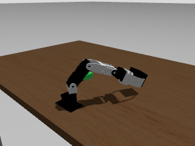

# 専門機能をデータ生成器として使うCRANE+ Pick-and-Place

Day5の演習を土台に、Jev、MoveIt 2、ROS 2 controllerで成功動作を作り、その記録から一つの学習ポリシーを作れるかを試しました。
複数の専門機能から単一ポリシーへのこの移行を、ここでは「振る舞いの蒸留（behavioral distillation）」と呼びます。

## 1. なぜこの構成を試したか

### Day5の演習から始めた

最終課題では、AIをロボットの行動へ接続し、実装、動画、ソースコード、レポートで示す必要がありました。
出発点には、応用編1 Day5で扱った一連の流れを選びました。
Day5では、ROS 2とGazebo上のCRANE+ V2をテレオペし、rosbag2へ記録し、LeRobotDatasetへ変換してACT（Action Chunking with Transformers）を学習し、シミュレータへ戻すところまでを扱っています。
この下流パイプラインを、今回の課題でも再利用する方針としました。

### 入力手段を変える案を試した

はじめに、ゲームコントローラでTurtleBot3を操作し、移動デモを集める案を比較対象としました。
再現しやすい構成ですが、講義を通じて関心を持ったマニピュレーションとaction chunkを扱うには、CRANE+ V2の方が課題の狙いに合います。
この案は比較候補にとどめ、最終構成としては実装していません。

次に、手元のMeta Quest 2をCRANE+ V2のテレオペ入力として使う経路を検証しました。
Quest2ROSのmessageとTCP endpointをbuildし、Quest 2からPCへ接続してcontroller入力が届くところまでは確認できています。
一方、controllerの6DoF poseをアームの手先目標へ変換する経路と、robotのcamera imageやstateをVR内で確認しながら操作するloopは完成しませんでした。
この状態では、操作者が結果を見ながら修正できず、画像付きの成功デモを同じ品質で反復収集することは困難です。

### Quest 2で詰まり、デモ生成へ方針を変えた

この試行から見えたボトルネックは、ACTの学習codeよりも、成功した画像付きデモを安定して増やす部分です。
そこでDay5の`rosbag2 → LeRobotDataset → ACT → Gazebo`は残し、デモを作る主体だけを人間から**教師システム**へ置き換えました。
Jevがtransfer strategyを選び、MoveIt 2が各phaseの軌道を計画し、ROS 2 controllerがGazebo上で実行します。
この成功動作を画像、関節状態、action、判断記録とともに保存すれば、同じ収集条件でepisodeを増やし、失敗したbagも規則に従って除外できます。

ここで私は、データ不足をモデルの改良だけの問題として扱わず、成功デモを作る工程から見直すことにしました。
実機テレオペは価値が高い一方、robot、operator、収録時間を増やさなければepisode数を増やせず、失敗や同期ずれの検査にも手間がかかります。
既に役割が分かった専門機能をデータ生成器として使い、条件付き成功デモを反復生成できれば、実機データを補う一つの経路になります。

| 段階 | 候補 | 確認したこと | 判断 |
| --- | --- | --- | --- |
| 出発点 | Day5 keyboard teleop | 収録、変換、学習、デプロイの流れ | 下流パイプラインを再利用 |
| 比較候補 | TurtleBot3 + gamepad | 移動デモを集める構成 | 比較のみ。最終構成には不採用 |
| 接続検証 | Quest 2 + CRANE+ | 通信、ROS 2 message、controller入力 | 知覚と操作のloopが未完成 |
| 採用構成 | Jev + MoveIt 2 + controller | 条件付き成功デモの反復生成 | 教師システムとして採用 |

この構成で確かめたかったことは二つです。

1. 判断、軌道計画、制御を組み合わせ、条件を変えた成功デモを反復生成して、学習可能なマルチモーダルデータセットへ変換できるか。
2. 収集したデータ量と多様性で、学習ポリシーは教師システムの振る舞いをどこまで再現できるか。

このレポートでは、Jev、MoveIt 2、ROS 2 controllerの組み合わせを**教師システム**、そこから収集したデモを学習するACTを**学習ポリシー**と呼びます。
教師システムの軌道をデモとして記録し、模倣学習でACTへ移す過程が、本稿でいう**振る舞いの蒸留（behavioral distillation）**です。
これは説明のための呼称であり、soft targetを使う一般的なknowledge distillationや、新しい蒸留アルゴリズムの提案ではありません。

教師システムは、効率を優先して持ち上げ位置から直接運ぶ`direct_transfer`と、いったん既知のhome姿勢を経由する`home_transfer`を生成します。
固定カメラからも経路条件が分かるように、作業台上の固定位置へ5 cm角、厚さ2.5 cmの箱形マーカーを置きました。
緑のマーカーは`direct_clear → direct_transfer`、橙のマーカーは`home_safe → home_transfer`を表し、各episodeでは該当する片方だけをカメラ画像内に表示します。
これは既知の経路条件を画像へ符号化するためのroute cueであり、実際の障害物ではありません。
ACTにはこの画像と現在の5関節状態を渡し、次の絶対関節目標をまとめて予測させました。

教師動作の生成から収録、同期、LeRobotDatasetへの変換、ACT学習、Gazeboでのclosed-loop実行までは接続できました。
ただし、全工程の学習ポリシーは45秒間動作したものの、キューブを把持できませんでした。
そこで、最初に失敗した区間を`descend → grasp → lift`へ限定して学習し直しました。
学習対象外から選んだ3条件では、終了時のキューブZ座標が20.02〜21.24 mm増えています。
今回示せたのは、自動データ生成パイプラインが一通り動くことと、全工程では未達だった連続動作から局所区間を切り出し、キューブの鉛直変位が生じる条件を診断できることです。
pick-and-place全体の再現には至っていません。

## 2. 何をもって成功としたか

対象タスクは、初期位置`(x=0.000, y≈-0.100)`にある木製キューブを把持し、右側の指定位置へ運び、解放するpick-and-placeです。
評価は一つの数字にまとめず、次の三段階に分けました。

| 評価段階 | 確認したこと | 判定 |
| --- | --- | --- |
| 教師システム | キューブを0.10 mより大きく移動し、目標位置から0.06 m未満、最終高さ1.03〜1.09 mへ置く | 採用episode 20 / 20成功。初回は19 / 20で、DDS timeoutの1本を同条件で再収集 |
| オフライン推論 | checkpointを再読込し、各episode先頭frameから有限な5次元actionを出せるか | 20 / 20で有限値、平均MAE 0.0461 |
| closed-loop | ACTのactionだけでGazebo上のキューブを把持・搬送・配置できるか | 1 rolloutを実施、未達 |

オフライン評価は、学習に使った20 episodeから先頭frameを1件ずつ選んだsanity checkです。
学習済みモデルの入出力が成立することを調べるための確認であり、汎化性能は評価していません。
closed-loop評価も`home_safe`条件の1回だけであり、成功率を推定できる回数には達していません。

### 二つの「三段階」を分けて読む

本実験には、意味の異なる二つの三段階があります。
一つ目は作業を時間方向に分けた動作区間です。
接近、下降、把持、持ち上げ、搬送、解放、復帰という全工程のうち、局所再学習では下降、把持、持ち上げだけを切り出しました。
二つ目は評価方法の段階です。
あらかじめ組んだ教師システムが成功するか、保存データに対してモデルが近い関節指令を返すか、最後にモデルの指令だけでGazebo上のロボットと物体を動かせるか、の順に確認します。
前者は「どの動作区間を学習したか」、後者は「どこまで性能を実証したか」を表す別の軸です。
局所再学習で確認したのは、下降、把持、持ち上げを含む連続区間を実行した後のキューブZ座標の増加です。
接触状態や、グリッパがキューブを支持し続けたかは判定していないため、把持成功を実証した結果ではありません。
搬送、解放、復帰を含む全工程の成功には数えていません。

### 下降・把持・持ち上げ区間をどう教師データ化し、ACTへ学習させたか

一言でいえば、成功例のカメラ画像と関節の動きをモデルへ見せ、収集範囲内の別の開始条件でも「次に各モーターをどの角度へ動かすか」を再現させる学習です。
ACT（Action Chunking with Transformers）は、現在の画像と関節状態から、これから実行する複数時点の関節目標をまとめて予測する模倣学習モデルです。

下降、把持、持ち上げごとに別モデルを作ったわけではありません。
教師システムが1回作業した記録から、下降の開始から搬送の直前までを一つの連続した手本として切り出し、**1個のACT**へ模倣学習させました。
記録内の`descend`、`grasp`、`lift`という名前は、切り出す時刻を見つけるためだけに使います。
モデルへphase名を答えさせたり、phase名を入力したりはしていません。

| 動作区間 | 成功例でロボットが行うこと | モデルが再現する関節の動き |
| --- | --- | --- |
| 下降（`descend`） | グリッパを開いたまま、キューブ上方から把持位置までアームを下げる | カメラに映るキューブと現在の姿勢に合わせ、アーム4軸を下降させる |
| 把持（`grasp`） | 把持位置でアームを保ち、グリッパを閉じる | アームの姿勢を大きく崩さず、グリッパ1軸を閉じる |
| 持ち上げ（`lift`） | グリッパを閉じたまま、キューブを鉛直方向へ持ち上げる | キューブを保持しながら、アーム4軸を持ち上げ方向へ動かす |

モデルへ渡す入力と教師目標は、次の組み合わせです。

| このレポートの用語 | 第三者向けの読み替え |
| --- | --- |
| 観測（入力） | 固定カメラのカラー画像（RGB）1枚と、その時点のアーム4軸・グリッパ1軸の角度 |
| action（教師目標） | controllerへ与えた、アーム4軸とグリッパ1軸の目標角度。1時点につき合計5個の数値 |
| 20 Hz | 0.05秒ごとに画像、現在角度、次の目標角度を一組にすること |
| action chunk | ある時点の観測1組に対し、その時点から先の目標角度を最大100時点分まとめたもの。出力は最大100 × 5個の数値で、20 Hzでは最大5秒分 |
| episode | ロボットが作業を最初から最後まで1回行った記録 |
| holdout | 学習には見せず、学習後の確認だけに使う別の作業記録 |

1件の学習sampleは、時刻tのRGB画像1枚と実測した5関節角を入力にし、時刻t以降にcontrollerへ送られた最大100時点 × 5関節の目標角を教師目標にします。
episode終端まで100時点に満たない場合は固定長までpaddingし、`action_is_pad`で印を付けた不足部分をloss計算から除外します。

局所学習用の40回は、最初に収集した`baseline-20`へ、キューブ位置と実行速度の範囲を広げた20回を加えた`diverse-40`です。
全工程を含む`baseline-20`は15,016時点ですが、局所学習では各episodeを下降開始から搬送直前までに切り詰めたため、40回でも4,467時点になります。
同じ拡張範囲内で別に収集した6回、661時点は全学習manifestから除外して確認用にしました。

ACTが覚えるのは、「いまは把持段階である」という分類ではありません。
画像と現在の5関節角を受け取り、下降、把持、持ち上げへ続く関節指令の並びを出す関係です。

全工程の評価では、実行中の画像を繰り返し取り込み、ACTを再推論しながら次の関節指令を更新しましたが、pick-and-placeは完了しませんでした。
一方、局所診断では、確認用記録と同じ開始姿勢とキューブ位置をGazebo上へ再現し、ACTが最初の観測から生成した100時点 × 5関節の目標角を、方策で再推論せずに1回だけ実行しました。
この間も、低位の関節controllerによるfeedback制御は継続しています。
この試験で確認したのは、キューブの高さが約20 mm増える局所的な動きです。
搬送先まで運んで解放する作業全体や、厳密な把持成功を確認した試験ではありません。

## 3. 各要素を組み合わせた理由

| 要素 | 入力 | 出力・責務 | 採用理由 |
| --- | --- | --- | --- |
| Jev | 経路候補、作業条件、最適化目標 | strategy、confidence、候補確率 | 判断をschema付きで保存し、条件が増えたときにも同じ境界で拡張するため |
| MoveIt 2 | strategyと各phaseの目標姿勢 | 衝突を避けた関節軌道 | 幾何計画を学習モデルへ任せず、成功デモを安定して生成するため |
| ROS 2 controller | 関節軌道 | Gazebo内の関節運動 | 軌道を実行し、referenceとfeedbackを収録するため |
| rosbag2 | 非同期のROS 2 topic | 時刻付きの生データ | 収集時の証拠を残し、変換を後からやり直せるようにするため |
| LeRobotDataset | 監査済みbag | 20 Hzでそろった画像、state、action | ACTが読めるepisode形式と正規化統計を作るため |
| ACT | RGB画像と現在の関節状態 | 100 stepの絶対関節目標chunk | 画像条件付きの連続actionをまとめて生成するため |

### 実装時のノード構成

ROS 2のノードは、センサや関節と一対一に置くものではなく、処理上の責務ごとに分けています。
今回の実装では、教師デモを収集するときと、学習済みACTを実行するときで、動くノード構成も分けました。

教師デモ収集時の主な流れは次のとおりです。

1. Gazeboの固定カメラと関節状態を、`ros_gz_bridge`と`joint_state_broadcaster`がROS 2 topicへ出す。
2. `parameterized_pick_place` executable内の`parameterized_pick_place_arm`と`parameterized_pick_place_gripper`が、phase進行とMoveIt 2への目標指定を担当する。
3. `parameterized_pick_place_arm`が`/jev_crane/phase_request`を発行し、`jev_phase_selector`がJev APIへ問い合わせる。
4. `jev_phase_selector`が`/jev_crane/selected_phase`を返し、選ばれたstrategyに応じてMoveIt 2の`move_group`が関節軌道を計画する。
5. `controller_manager`配下のarm / gripper controllerが軌道を実行し、rosbag2 recorderが画像、関節状態、controller reference、phase、Jev判断を記録する。

一方、学習済みACTのclosed-loop実行では、JevとMoveIt 2を推論経路から外しています。
`act_rollout_controller`が`/camera/image_raw`と`/joint_states`を受け取り、localhost HTTPでPython 3.12側のACT inference serverへ渡します。
返された5関節の目標値を安全範囲と1 stepあたりの変化量で制限し、arm / gripper controllerへ送ります。

```text
教師デモ収集
Gazebo sensor -> ros_gz_bridge / joint_state_broadcaster -> ROS 2 topics
                                      |                         |
parameterized_pick_place <-> jev_phase_selector <-> Jev API    |
          |                                                     |
          +-> MoveIt 2 move_group -> controller_manager -> Gazebo
                                                                |
                                      rosbag2 recorder <---------+

学習済みACTの実行
/camera/image_raw + /joint_states
          -> act_rollout_controller <-> ACT inference server
          -> arm / gripper controller -> Gazebo

オフライン処理
rosbag2 -> audit / 20 Hz同期 -> LeRobotDataset -> ACT学習 -> checkpoint
```

したがって、関節ごとに独立したROS 2ノードを作ったわけではありません。
複数関節の実行はcontroller群が担い、上位のノードは判断、phase進行、観測と推論の接続といった責務を持ちます。
また、Jev API、ACT inference server、bag変換、ACT学習は、ROS 2 topic graphの外にある外部処理です。

### Jevが必要だったか

出発点にあった課題は、条件ごとに異なる成功デモを増やすと、**なぜその経路を選んだか**が軌道だけからは分からなくなることでした。
条件判定、経路方針の選択、軌道生成を一つのif文へ重ねると、候補や最適化目標を追加するたびに実行コードを書き換える必要があり、判断根拠、confidence、fallbackも共通形式で残りません。

そこで、次の境界を設けました。

1. 作業条件、選択候補、最適化目標を判断層へ渡す。
2. 判断層はstrategy、confidence、候補確率をJSON schemaで返す。
3. MoveIt 2は選ばれたstrategyから関節軌道を生成し、ROS 2 controllerが実行する。
4. rosbag2には、判断結果と、その結果に沿って生成された観測・関節運動を同じepisodeの証拠として残す。

Jevは、この判断層を構造化入出力で実装するために採用しました。
今回の二択だけならif文で十分であり、Jevの必要性そのものを実証したわけではありません。
確認したのは、条件や候補が増えても実行層を変えずに判断層を差し替えられる構成と、判断理由を伴う教師デモ生成の経路です。

ここでいうroute cueは、作業台上の固定位置へ表示する5 cm角の箱形マーカーです。
緑は`direct_clear → direct_transfer`、橙は`home_safe → home_transfer`に対応し、各episodeでは片方だけを表示します。
障害物を画像で認識して経路を推論する能力は評価対象に含めていません。

### Jevへ渡した入力

実装では、ROS 2の`/jev_crane/phase_request`から受け取った候補と作業条件に、最新の`/camera/image_raw`をJPEG化して加え、`image_text`モードのJSON payloadを組み立てました。
以下は`direct_clear`条件の代表例です。
認証headerと`data_base64`の画像本体だけを省略しており、key名と指示文は`phase_selector.py`の実装に対応しています。

```json
{
  "model": "jev-latest",
  "state": {
    "task": "Choose a safe transfer strategy for a simulated CRANE+ pick-and-place episode after the cube has been grasped and lifted.",
    "current_phase": "lifted",
    "candidate_descriptions": {
      "home_transfer": "Move to the known home pose before approaching the placement target. This is longer but provides a stable, repeatable transfer path.",
      "direct_transfer": "Plan directly from the lifted grasp pose to the placement target. This is shorter but can be harder to plan near the table."
    },
    "task_context": {
      "route_profile": "direct_clear",
      "direct_path_clear": true,
      "optimization_goal": "efficiency",
      "route_cue": "green"
    },
    "camera_frame": "jev-camera-frame"
  },
  "questions": {
    "next_strategy": {
      "type": "choice",
      "instructions": "Inspect `camera_frame` and the supplied task_context, then choose one candidate. The visible route cue and structured context encode the same condition and should agree.",
      "criteria": {
        "home_transfer": "Move to the known home pose before approaching the placement target. This is longer but provides a stable, repeatable transfer path.",
        "direct_transfer": "Plan directly from the lifted grasp pose to the placement target. This is shorter but can be harder to plan near the table."
      }
    }
  },
  "assets": {
    "jev-camera-frame": {
      "type": "image",
      "format": "jpg",
      "data_base64": "<JPEG bytes omitted>"
    }
  }
}
```

Jevから受け取るのは`choice`、`confidence`、候補ごとの`probabilities`です。
この出力を検証し、候補外、confidence 0.55未満、API errorの場合は`recommended`へfallbackした後、選ばれたstrategyをMoveIt 2へ渡しました。
Jevの出力は、後段の軌道計画を切り替える構造化判断です。
関節軌道はMoveIt 2が生成します。

### Jevが選ぶ2つの戦略

Jevへ問い合わせる時点では、キューブの把持と持ち上げまでは完了しています。
`approach → descend → grasp → lift`は両方の戦略に共通であり、Jevが選ぶのはlift後から配置位置までの搬送経路です。

| 選択肢 | 選択後の動き | 判断条件 | この経路の性質 |
| --- | --- | --- | --- |
| `direct_transfer` | lift後の姿勢から配置位置へ直接向かう | `direct_path_clear = true`かつ`optimization_goal = efficiency`。画像では緑のcue | 短く効率的だが、テーブル付近では軌道計画が難しくなり得る |
| `home_transfer` | いったん既知のhome姿勢へ戻り、そこから配置位置へ向かう | `direct_path_clear = false`または`optimization_goal = stability`。画像では橙のcue | 経路は長いが、既知姿勢を経由するため安定して再現しやすい |

Jevは候補から経路方針を一つ選び、`choice`、`confidence`、候補確率を返します。
選択結果を受けたMoveIt 2が、現在の姿勢から必要な中間姿勢と配置姿勢までの関節軌道を計画します。
ROS 2 controllerはその軌道を実行するため、Jev自身が関節角やモータ指令を生成しているわけではありません。

今回の緑と橙のcueは、あらかじめ設定した経路条件を画像から読み取れるようにする制御ラベルです。
障害物を検出して未知の経路を発見する実験ではありません。
一方、この判断境界は候補を増やせるため、将来は障害物の左右を通る経路、上方へ退避する経路、速度優先と安定性優先などを同じschemaで比較できます。

### 実例: episode 410の判断から学習データまで

`pick-place-var-410`では、キューブを`y = -0.098556 m`へ置き、緑のcueと`direct_clear`条件を設定しました。
アームは`approach → descend → grasp → lift`まで共通の教師動作を実行し、lift後の21.781秒時点でJevへ経路選択を問い合わせました。
Jevの実応答は次のとおりです。

```json
{
  "choice": "direct_transfer",
  "confidence": 1.0,
  "probabilities": {
    "home_transfer": 0.0,
    "direct_transfer": 1.0
  },
  "fallback_reason": null
}
```

この応答を受けると、MoveIt 2はhome姿勢を経由せず、lift後の姿勢から配置位置へ直接向かう軌道を計画します。
ROS 2 controllerが軌道を実行し、episodeは`release → return_home → completed`まで進みました。
配置誤差は6.52 mmでした。



ここで、Jevのrequest、decision、phase名は判断の監査とepisodeの切り出しに使いますが、ACTの入力や教師actionには直接含めていません。
ACTが学ぶのは、実行中に記録した固定カメラ画像、現在の5関節角、同時刻のcontroller referenceです。
episode 410は20 Hzの713 frameへ変換されました。
次は、そのうちJev判断直後に相当するframe 436の実データを小数第6位へ丸めた例です。

```json
{
  "episode_index": 0,
  "frame_index": 436,
  "timestamp_s": 21.80,
  "observation.images.front": "frame-000436.png",
  "observation.state": [-0.397441, 0.780200, 0.000688, -1.189075, 0.108013],
  "action": [-0.324822, 0.831131, 0.108242, -1.173129, 0.174441],
  "task": "pick_wood_cube_and_place_right"
}
```

`observation.state`はその時点の実際の関節角、`action`は教師システムがcontrollerへ与えた次の絶対関節目標です。
ACT学習時には、この1 frameの観測に対して、現在位置から続く最大100 step、20 Hzで最大5秒分のaction列を教師chunkとして組み立てます。
したがって、Jevの一回の判断をラベルとして覚えるのではなく、その判断によって作られた一連の画像付き関節運動を模倣します。

| 記録 | rosbag2に保存 | ACTの学習feature |
| --- | --- | --- |
| Jev request / decision | 保存する | 含めない |
| phase名 | 保存する | 含めない。監査と切り出しに使用 |
| 固定RGB画像 | 保存する | `observation.images.front` |
| 現在関節角 | 保存する | `observation.state` |
| controller reference | 保存する | `action` |
| タスク名 | データセット変換時に付与 | 条件文字列として保持 |

2 strategy pilot全体では、episode 410の713 frameとepisode 411の785 frameを合わせた1,498 frameが学習データです。
最終的な`baseline-20`では、同じ変換規則で20 episode、15,016 frameを使用しました。

rosbag2とLeRobotDatasetも役割が異なります。
前者はtopicごとの時刻と原メッセージを保持する証拠層、後者は20 Hzへ同期し、学習で反復読込できる形式へ整えた学習層です。

## 4. 実行環境とデータschema

### 実行環境

| 項目 | 条件 |
| --- | --- |
| Host | Windows 11 Pro 64-bit、AMD Ryzen 9 7900X |
| GPU | NVIDIA GeForce RTX 5070、VRAM 12,227 MiB、driver 610.88 |
| Container host | Docker Desktop 4.97.0、Docker Engine 29.9.2 |
| Runtime image | `airobotbook/ros2-desktop-ai-robot-book-humble@sha256:b58ec74c019aacd9ce4818fa25fc5a9e0a1f22f8c9cd1f5260994bf15cd9eb63`、Ubuntu 22.04 |
| 環境固定 | multi-stage Dockerfile、Python 3.12.16、uv 0.13.6、101 package lock |
| ROS / motion planning | ROS 2 Humble base package `0.10.0-1jammy.20250114.175320`、MoveIt 2 package `2.5.7-1jammy.20250114.205048` |
| Simulation bridge | `ros_gz_sim 0.244.16-2jammy.20241205.203411`。Gazebo / Ignitionを含むruntime全体は上記image digestで固定 |
| Robot model / source | CRANE+ V2、`AI-Robot-Book-Humble/crane_plus` revision `19c1d6069126cd27488bf1bbefd410704bfc515d` |
| Jev service / model | TypeSafe AI Jev API、model identifier `jev-latest`、利用日2026-10-31。immutable model revisionは取得していない |
| Quest input pilot | Meta Quest 2、Quest2ROS ROS 2 branch commit `6e9e8afec0e00da4da9e6650cfe69e21bb500aad`。接続検証のみで最終構成には不使用 |
| Learning stack | LeRobot 0.6.1、PyTorch 2.11.0+cu128、torchvision 0.26.0+cu128、NumPy 2.2.6 |
| ACT model | LeRobot 0.6.1のACT実装、ImageNet事前学習済みResNet18、checkpoint `model.safetensors` SHA-256 `5875097687d4e008e161f994762ce342e99b6f0920cbe5d10d623edf502c58dc` |

固定versionを取得できたものはversion、commit、digest、artifact hashで示しました。
`jev-latest`はmutableなmodel identifierであり、2026-10-31に利用したモデルを同一revisionとして再取得できることまでは保証できません。

### 観測と行動

| Feature | Shape | 内容 |
| --- | ---: | --- |
| `observation.images.front` | `3 × 240 × 320` | 作業台、アーム、キューブ、route cueを含む固定RGBカメラ |
| `observation.state` | `5` | controller定義順のjoint1、joint2、joint4、joint3、gripperの現在角度 |
| `action` | `5` | 同じ順序のcontroller reference。絶対関節目標、単位はrad |

変換器は、画像、joint state、arm controller reference、gripper controller referenceをbagのtimestampで並べ、直前値保持で20 Hzの共通gridへ載せます。
画像、state、actionはLeRobotのpreprocessorでmean / standard deviation正規化し、推論後にpostprocessorで元の関節値へ戻します。

### ACT学習条件

| 項目 | 値 |
| --- | ---: |
| Backbone | ImageNet事前学習済みResNet18 |
| Parameter | 約52M |
| `chunk_size` / `n_action_steps` | 100 / 100 |
| Batch size | 4 |
| Optimizer | AdamW |
| Learning rate / weight decay | `1e-5` / `1e-4` |
| Gradient clip norm | 10.0 |
| KL weight / latent dim | 10.0 / 32 |
| Training seed | 1000 |
| Image augmentation | 無効 |
| Temporal ensembling | 無効（`temporal_ensemble_coeff: null`） |
| Dataset split | 分割なし、20 episodeすべてを学習に使用 |

## 5. 教師データをどう作ったか

収集では、キューブのy座標を`-0.103〜-0.097 m`の狭い範囲で変え、`direct_clear`と`home_safe`を交互に割り当てました。
乱数seedは`20261106`です。
各episodeの開始前にキューブとroute cueを再配置し、Jevへ候補、推奨strategy、`direct_path_clear`、`optimization_goal`を渡す構成です。

Jevは`direct_transfer`または`home_transfer`を返します。
confidenceが0.55未満、候補外の応答、API errorの場合は推奨strategyへfallbackします。
採用した20 episodeにfallbackはありません。

MoveIt 2はapproach、grasp、lift、transfer、release、returnを順に計画します。
動作中はカメラ画像、joint state、controller reference、task context、phase、Jev request / decisionをrosbag2へ保存します。
収集後には必須topic、画像形式、timestamp逆行、周期、最終poseを監査し、成功したepisodeだけを学習データセットへ昇格させました。

初回収集の結果は19 / 20本の成功です。
失敗した1本は、task開始前のMoveIt action goal responseでDDS timeoutになったため、同じ条件で取り直しました。
取り直し後の20本を最初の全工程データセットとし、`direct_clear` 10本、`home_safe` 10本、合計15,016 frameへ変換しています。

### 20本から40本へ増やした経路

全工程データセットの量と条件幅を分けて調べるため、最初の20本を固定し、同じ条件範囲から20本を加えた`narrow-40`と、キューブ位置・実行速度の範囲を広げた20本を加えた`diverse-40`を作りました。
追加収集にはJevの`image_text`入力を使い、全episodeをbag監査へ通しています。
比較用には、学習に含めない6 episodeを共通holdoutとして固定しました。
内訳は、多様化motion pilotのepisode 700〜703と、Jev `image_text` pilotのepisode 710〜711です。
キューブy座標は`-0.104209〜-0.096274 m`、速度scaleは`0.7340〜0.7963`で、広げた条件範囲内の別収集データです。
ここでいう「未学習」は学習manifestへ含めていないことを意味し、未知分布への汎化を意味しません。

| Dataset | 構成 | 主な用途 |
| --- | --- | --- |
| `baseline-20` | 最初の20 episode | 基準条件 |
| `narrow-40` | `baseline-20` + 元の範囲に近い20 episode | 量を増やす比較 |
| `diverse-40` | `baseline-20` + 位置・速度範囲を広げた20 episode | 条件幅を増やす比較、phase分割学習 |
| `holdout-6` | いずれの学習にも含めない6 episode | オフライン評価と単一chunk局所診断 |

2,000 step時点の共通holdout first-frame MAEは、`baseline-20`が0.0775、`narrow-40`が0.0661、`diverse-40`が0.1030でした。
この条件では量の追加による改善を観測しましたが、条件幅を広げた効果は確認できませんでした。
`diverse-40`を4,000 stepまで延長すると0.0838まで下がりましたが、全工程rolloutではキューブを動かせませんでした。

## 6. 学習と評価の進め方

最初の200 stepではAMPを有効にしましたが、gradient normは`nan`でした。
RTX 5070上で計算自体は継続したものの、更新の健全性を確認できないため、そのcheckpointを最終評価には使いませんでした。

次の試行ではAMPを無効化し、400 stepまでFP32で学習しました。
そのcheckpointから学習を再開し、合計2,000 stepまで延長しています。
各checkpointではlossだけを見ず、保存したモデルを新しいprocessで読み直し、オフラインactionとGazebo rolloutを順に確認する手順です。

closed-loopでは、ROS 2 HumbleのPython 3.10とLeRobotのPython 3.12をlocalhost HTTPで分離しています。
controllerは20 Hzで最新画像と5関節stateを送り、ACTが返したactionの先頭stepを絶対関節目標として使います。
報告した全工程rolloutにおける1 commandの最大変化量は0.08 radです。
READMEの再現例は初回試行をさらに保守的にするため0.05 radを指定しています。
phase分割の診断では100 actionを途中で切らず実行するため0.30 radとし、全工程との性能比較には使っていません。
局所評価の開始前には、切り出したholdout episodeの先頭関節状態へアームを移動しています。
この準備動作でキューブを動かさないよう、一時的にキューブを作業領域外へ退避させ、関節移動後に元のキューブ位置とroute cueを復元しました。
ACTのtemporal ensemblingは使用していません。
いずれの条件でも、関節可動域へのclampを併用しています。
3回連続で推論に失敗した場合、または45秒に到達した場合は停止します。

## 7. 結果

### 教師システムとデータセット

| 指標 | 結果 |
| --- | ---: |
| 採用episode | 20 |
| `direct_clear` / `home_safe` | 10 / 10 |
| rosbag2監査合格 | 20 / 20 |
| Camera image | 12,633件 |
| Jev decision / fallback | 20 / 0 |
| Timestamp逆行 | 0件 |
| 平均 / 最大配置誤差 | 5.65 / 15.47 mm |
| LeRobotDataset | 15,016 frame、20 Hz |

画像message数よりLeRobotDatasetのframe数が多いのは、20 Hzの共通時刻gridへ変換する際に、各時刻で直前の画像を保持してstateとactionへ対応付けたためです。

代表例の配置誤差は、`direct_transfer`が5.93 mm、`home_transfer`が7.58 mmでした。

### ACT

| Checkpoint | Loss | Gradient norm | オフラインfirst-action MAE | closed-loop |
| --- | ---: | ---: | ---: | --- |
| 200 step / AMP | 10.650 | `nan` | 0.617 | 未達 |
| 400 step / FP32 | 3.367 | 125.532 | 0.595 | 未達 |
| 2,000 step / FP32 | 1.500 | 77.821 | 0.0461 | 未達 |

2,000 step checkpointは、20 episodeの先頭frameすべてで有限なactionを返しています。
45秒のGazebo rolloutにおける出力は882 actionです。
20.03 Hzはaction timestamp間隔から求めた実行中rateで、壁時計45秒との単純除算ではありません。
推論レイテンシ中央値は3.30 msでした。
最初の推論だけは857 msを要しています。

アームは45秒間に882 actionを実行して把持姿勢の方向へ動きましたが、キューブのposeは開始前後で変化しませんでした。
rolloutはtime limitで終了し、task successはfalseでした。

### 失敗地点を分離した再評価

全工程の最初の失敗点を詳しく調べるため、教師episodeを`descend`開始から`transfer`直前まで切り出しています。
学習条件は40 episode、4,467 frame、2,000 stepです。
同じ変換規則で作った未学習6 episode、661 frameをholdoutにしました。

| 指標 | 結果 |
| --- | ---: |
| 最終loss | 1.377 |
| Gradient norm | 80.725 |
| Training 40 episodeのfirst-frame MAE | 0.0301 rad |
| Holdout 6 episodeのfirst-frame MAE | 0.0259 rad |
| Holdout episode 0の100-action chunk MAE | 0.0148 rad |

Holdout 6本のうち、両route labelを含み、キューブy位置が異なる3条件だけを事後的な診断subsetとして選びました。
各条件の開始姿勢とキューブ位置はGazeboへ再現しています。
残り3本はこの局所診断の評価対象ではありません。
この3条件は事後的な診断subsetであり、母集団の成功率推定には使いません。
初期観測からACTが生成した100 actionは、20 Hz、`max_delta=0.30`で一度だけ最後まで実行しています。
chunk中にpolicyの再推論は行いませんが、低位の関節controllerはfeedback制御を続けます。
全工程評価の`max_delta=0.08`とは条件が異なるため、同じ評価条件での改善比較ではありません。
学習対象外から選んだ3初期条件におけるキューブZ座標の増加量は、20.02、20.16、21.24 mmです。
局所基準は終了時のZ増加15 mm以上としました。
小さなpose変動と明確な鉛直変位を区別する診断閾値として実験後に導入したもので、接触、支持状態、厳密なgraspを判定する基準ではありません。
選んだ3条件は、いずれもこの局所基準を満たしています。
episode 710の再計測では100 actionをすべて保存し、2秒後も高さが維持されました。
この結果は、搬送、解放、復帰を含むpick-and-place全体の成功ではありません。

## 8. 結果から何が言えるか

収集から推論までの経路は一通り接続できています。
具体的には、Jev判断の記録、MoveIt 2による教師軌道、rosbag2収録、20 Hz同期、LeRobotDataset読込、ACT学習、checkpoint再読込、画像前処理、action逆正規化、ROS 2 controllerへの接続を一続きで確認しました。

ACTがpick-and-place全体を学習したとは言えません。
オフラインMAEは学習データセットの先頭frameだけを測った値であり、その教師actionはほぼhome姿勢です。
0.0461への低下はcheckpointが有限なactionを返すsanity checkにはなりますが、episode全体の追従や汎化を示すものではありません。

全工程のrolloutだけでは、未達原因をcovariate shiftだけに絞る証拠は得られていません。
データセットが20 episodeと狭いこと、初期frameへ偏ったオフライン評価、action chunk 100に対して先頭actionだけを逐次実行したこと、画像augmentationを使っていないこと、action clampが軌道を変えた可能性が残ります。
最初に教師軌道から外れた時刻、phase別誤差、clamp回数は今回のlogでは測れていません。

その後のphase分割実験で確認できたのは、学習対象外から事後選択した3条件における局所的なキューブZ増加動作です。
学習区間、初期状態、データ構成、実行条件を同時に変えているため、どの変更が寄与したかは分離できていません。
全工程を一つの成否だけで評価するより、phase単位で成立可能性を確かめる方が、次に追加すべきデータと評価を判断しやすくなります。
次は`transfer`、`release`、`return_home`を順に追加し、成立範囲がどこで崩れるかを測ります。

次の実験では、episode単位でtrain / validation / testを分け、全frameとphase別の誤差を測ります。
closed-loopは複数の初期配置と両route条件で少なくとも5回ずつ実行し、成功率とTask Completionを記録します。
同時にraw action、clamp後action、joint errorを保存し、最初の破綻点を特定します。

さらに、Jevの判断を搬送経路だけでなく、初動の位置合わせへ広げます。
箱を作業台上の複数位置へ配置し、固定カメラ画像と到達条件から、左・正面・右のどこから接近するか、home姿勢を経由するか、到達困難として停止するかをJevに選ばせます。
選ばれた方針をMoveIt 2が関節軌道へ変換し、ROS 2 controllerで実行した画像と関節運動を新しい教師episodeとして収録します。
この構成では、Jevが数秒単位の接近方針、MoveIt 2が幾何的な軌道、ACTが画像条件付きの連続関節動作、低位controllerが追従制御を担当します。
箱の位置を連続的に変えた学習用episodeと、学習に含めない配置を分離し、ACTが収集範囲内の別配置へ追従できるかを評価します。

## 9. 再現性と提出物

公開用sourceの範囲は、ROS 2 package、収集、bag監査、LeRobot変換、ACT学習、オフライン評価、推論server、rollout controller、提出動画生成です。
credential、bag、データセット、checkpoint、生成動画はリポジトリへ含めていません。
AI-Robot-Book-Humble由来codeについては、revision `19c1d6069126cd27488bf1bbefd410704bfc515d`のApache-2.0 sourceとして出典と変更箇所を明記しています。
上流READMEには、AX-12AのCADモデルについてROBOTISから使用許諾を得ていることと、関連する知的財産権がROBOTISに帰属することが明記されています。
本公開repositoryはCRANE+のCADやmesh、Docker image自体を再配布せず、実行時に外部環境から参照します。

公開repositoryは[uhiron55/physical-ai-2026-advanced-1-final-assignment](https://github.com/uhiron55/physical-ai-2026-advanced-1-final-assignment)です。
提出対象の固定commitは`SUBMISSION.md`と`submission-source-v14` tagに示しています。
提出動画は[YouTubeの限定公開URL](https://youtu.be/HnCxy8pZ3nA)で確認できます。
固定digestの新規containerでは、2 packageのbuild、camera / controller readiness、決定論的fallbackによる教師episodeを再実行しています。
配置誤差は2.81 mmでした。
大容量データセット、checkpoint、評価bagはGitへ含めず、`results/artifact_manifest.json`に論理path、size、SHA-256を記録しました。
公開repository、固定source commit、動画URLは`SUBMISSION.md`に集約し、`python3 scripts/validate_repository.py --release`で提出状態を検査します。

## 出典

- [AI-Robot-Book-Humble / crane_plus](https://github.com/AI-Robot-Book-Humble/crane_plus)
- [LeRobot](https://github.com/huggingface/lerobot)
- [ROS 2 Humble](https://docs.ros.org/en/humble/)
- [MoveIt 2](https://moveit.picknik.ai/)
- [ACT: Learning Fine-Grained Bimanual Manipulation with Low-Cost Hardware](https://arxiv.org/abs/2304.13705)
- [TypeSafe AI: Introducing System One Models & Jev](https://typesafe.ai/blog/introducing-system-one-models-and-jev)
- [Quest2ROS ROS 2 branch](https://github.com/Quest2ROS/quest2ros/tree/ros2)
